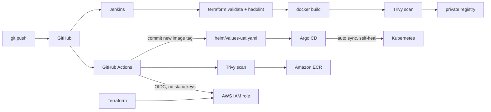

# devops-platform-lab

Hands-on DevOps / SRE lab: an application goes from a commit to a Kubernetes cluster through CI, image scanning, a container registry, Helm and GitOps, with the AWS side managed by Terraform.

Built as a structured learning programme on top of production operations experience (monitoring, incident response, AWS EKS).

## Architecture



## What is inside

| Area | Path | Highlights |
|---|---|---|
| **CI: GitHub Actions** | `.github/workflows/` | Build → **Trivy** scan (fails on CRITICAL) → push to **ECR** → commit the new image tag for GitOps. AWS access via **OIDC**, no long-lived keys. Separate `terraform fmt/validate` check on PRs. |
| **CI: Jenkins** | `Jenkinsfile`, `jenkins/` | Declarative pipeline: parallel checks (Terraform validate, hadolint), image build, Trivy scan, push with Jenkins credentials, cleanup in `post`. Custom Jenkins image with Docker CLI and plugins. |
| **IaC: Terraform** | `terraform/` | AWS provider pinned to one account, GitHub OIDC provider and a least-privilege IAM role scoped to this repository and ECR path. |
| **Packaging: Helm** | `helm/payment-service/` | Deployment, Service, ConfigMap, **HPA**, Ingress; per-environment values (`values-uat.yaml`). |
| **CD: Argo CD** | `argocd/` | Application with automated sync, `prune` and `selfHeal`: the cluster always matches Git. |
| **Kubernetes labs** | `lab/` | Probes, scheduling (taints/affinity), PDB, storage, RBAC, SLO burn-rate alerts. See [lab/README.md](lab/README.md). |

> **Note on AWS:** the AWS resources (IAM OIDC role, ECR) were deployed in a personal sandbox account and are currently torn down to avoid costs. The code is kept as a working reference. The GitHub Actions image build is switched to manual-only for this reason; the Terraform check workflow, Jenkins pipeline, Helm chart, Argo CD and Kubernetes labs all run without AWS.

## Key decisions

- **OIDC instead of AWS access keys** in CI: short-lived credentials, trust limited to this repository.
- **Scan before push**: a vulnerable image never reaches the registry.
- **GitOps**: CI does not touch the cluster. It only changes Git, and Argo CD applies it. Rollback = `git revert`.
- **Two CI systems on purpose**: GitHub Actions for the cloud flow, Jenkins for a self-hosted flow, to compare both approaches.

## Run locally

```bash
# Jenkins
docker build -t jenkins-lab jenkins/
docker run -d -p 8080:8080 -v /var/run/docker.sock:/var/run/docker.sock jenkins-lab

# Kubernetes (kind / k3d / minikube) + Argo CD
kubectl create namespace argocd
kubectl apply -n argocd -f https://raw.githubusercontent.com/argoproj/argo-cd/stable/manifests/install.yaml
kubectl apply -f argocd/payment-app.yaml

# Terraform (static checks, no AWS account needed)
cd terraform && terraform fmt -check && terraform init -backend=false && terraform validate
```

## Roadmap

- Terraform modules and remote state for VPC + EKS
- Ansible role for host configuration
- Prometheus / Grafana stack with the SLO rules from `lab/`
